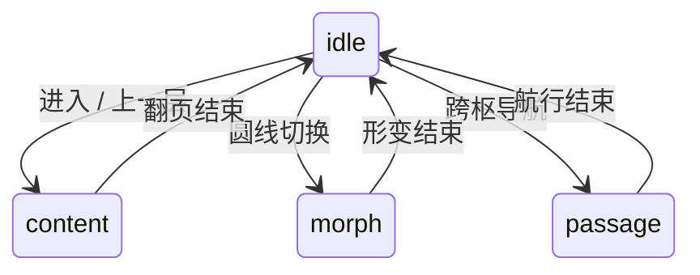
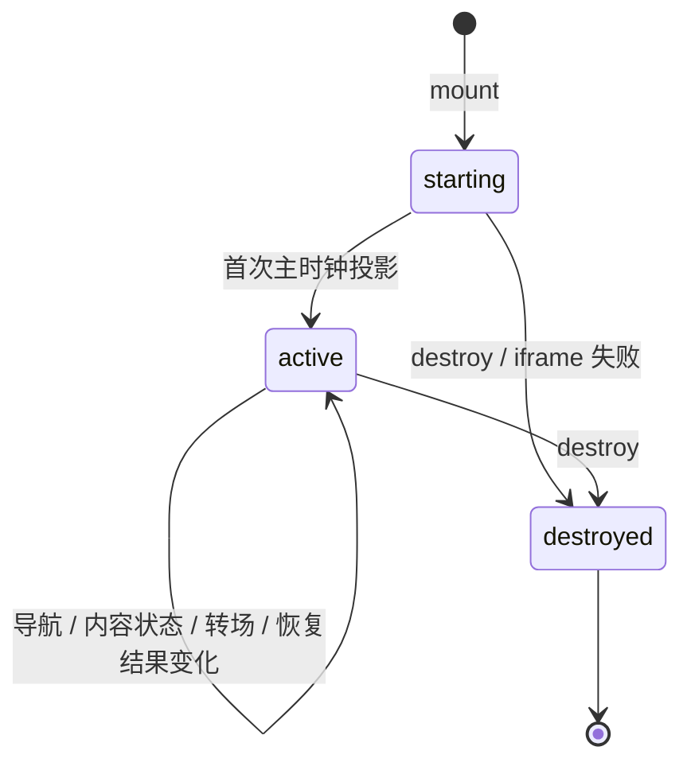
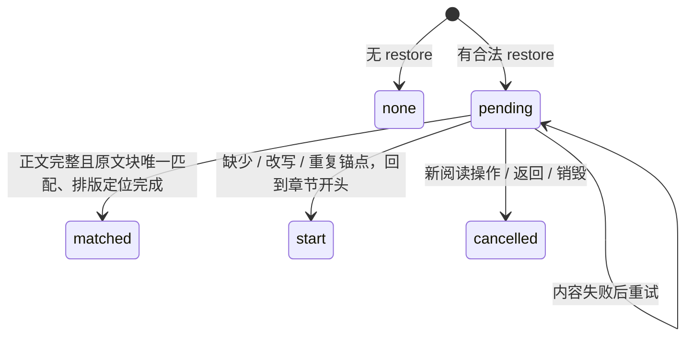

# 阅读器语义契约

以枢组织内容，以空间表达关系，以动效解释变化。全域用于定位，聚焦用于阅读；圆与线是同一枢的两种表达。正文、当前章节和可执行导航应始终比背景关系清晰。键盘、几何标签和具名按钮走同一个命令入口，减少动效保留相同的最终语义。

## 状态与事件的所有权

| 所有者 | 持有内容 | 边界与不变量 |
| --- | --- | --- |
| `Field` | 当前枢、章节路径、形态、历史、相机、导航意图 | 唯一导航所有者；结构转场只能是 idle / passage / morph / content 之一 |
| `ReadingSession` | 内容请求、首屏就绪、失败与取消 | 未可读的目标可等待，当前章节仍保留；返回可取消等待，迟到内容不能提交旧意图 |
| `ReadingPositions` / 阅读层 | 内容源位置、排版与可见锚点 | DOM 与像素留在内部；排版变更按内容重新定位 |
| `ReaderSessionAccess` | 一次挂载恢复请求 | 不另存导航历史；只在完整正文中校验锚点，再交给阅读层定位 |
| `ReaderObservation` | 最近一次不可变语义输出及订阅者 | 不写回 Field；不暴露对象引用；销毁后不再发活动状态 |

| 意图 | 空间与动效语义 |
| --- | --- |
| 同级步进 | 沿当前圆或线移动；到边界才使用声明的 `boundaryRoutes` 或通用导航规则 |
| 进入下一层 / 上一层 | 绕当前锚点翻页，结构转场为 content |
| 圆线切换 | 同一枢的 Möbius 形变，结构转场为 morph；章节身份不变 |
| 跨枢 | 空间航行，结构转场为 passage |
| 全域 / 回到阅读 | 改变观察范围；全域适配可见区域，聚焦保留正文可读尺度 |
| 返回 | 回到访问历史；完成的圆线切换不单独消耗历史。等待中的切换可取消 |

结构转场的互斥由判别联合保证。转场期间新的结构命令按现有 Field 规则排队；外部订阅不是逐帧动画或完整输入日志。



同级几何滑移、正文滚动和相机调整不新增结构转场；`motion: idle` 不表示每个像素都停止了。



`active` 并不等于正文已经加载完。`readable` 表示首次可读已发生，`content` 表示当前位置表达的内容状态；`request` 单独表示前台目标请求，可能仍在等待另一个章节或另一种表达。后台预取不作为前台事件。

## 只读订阅

`getState()` 返回最近一次主时钟结束后的投影。`subscribe(listener)` 同步通知当前值，随后只通知语义变化，返回幂等取消函数。每次注册独立；不会因逐帧相机插值或正文滚动反复通知。

活动状态包含：`location {hub, chapter, presentation}`、`view`、`readable`、`motion`、`content`、`request`、`restoration`。对象及嵌套位置均冻结且脱离内部状态。监听器可以取消订阅或销毁实例；销毁发一次终态并清理监听器。监听器异常通过 console.error 报告，其他监听器和阅读器继续工作。销毁后读取或订阅只得到终态，`snapshot()` 返回 null，dispatch 仍按旧约定抛错。

## 显式快照与恢复

```js
const stop = reader.subscribe(state => {
  if (state.status === 'active') {
    renderLocation(state.location, state.request, state.restoration);
  }
});

// 由消费者在明确的操作时机调用；null 表示此刻不能安全保存。
const saved = reader.snapshot();
if (saved) {
  const portable = JSON.parse(JSON.stringify(saved));
  stop();
  reader.destroy();
  reader = mountReader(host, definition, { restore: portable });
  // iframe 同样支持：mountEmbeddedReader(host, definition, { frameUrl, restore: portable })
}
```

版本 1 快照只有 `{version, location, anchor}`。锚点是唯一的完整原文块、块类型和块内 UTF-16 偏移；不含 DOM、像素、相机、动画进度或内部可变状态。没有可靠锚点时 anchor 为 null，仍可保存章节位置。单块超过 65536 个 UTF-16 单元或重复时不保存该锚点。

快照仅在正文完整、无前台内容请求/错误、无结构转场、文本滚动与锚点校正已稳定、且章节属于声明清单时可用。临时搜索结果返回 null。恢复总是进入聚焦阅读；不恢复历史栈、全域取景、主题、设置、搜索查询、选区或其他枢的书签。消费者可以另外传入初始 settings；restore 与 chapter/morph 不能同时提供。

无效结构、未知版本、清单中不存在或不属于指定枢的章节，都会在改动宿主前抛 TypeError；输入被复制并冻结。这个校验不证明作品身份，消费者须把快照交回对应的 ReaderDefinition。



恢复等待完整正文，避免流式内容后面出现重复段落而误判唯一性。已有 `ready` Promise 仍表示首次可读，可能早于恢复完成；订阅 restoration 可观察最终结果。无限流不会自动完成恢复；用户可以继续操作取消等待。开始新的命令、指针操作、滚轮或阅读按键后，不再因迟到内容跳回保存位置；重试按钮/重试命令保留同一个待恢复意图。恢复只执行一次，之后的替换或重排继续由现有阅读层处理。

## 阅读位置回退顺序

- 同一会话内圆线切换：完整正文相同或唯一稳定原文块匹配 → 目标表达自己的有效书签 → 开头。流式切换只判断一次，后来到达的段落不触发补跳。
- 销毁后的显式恢复：完整正文中唯一原文块匹配 → 开头。新会话没有旧表达书签；不按百分比、段落序号或旧像素猜测。

恢复目标按当前窗口和排版重新定位，保证语义位置而不承诺像素相同。几何正文与窗口正文共用源锚点，但各自负责排版校正。

## 嵌入与持久化边界

同页多实例仍用独立同源 HTTP(S) iframe；每个实例独立订阅、销毁、请求取消和恢复。直接文档入口仍只允许一个已连接的唯一 #scene。iframe 私有桥版本为 2，应整体更新分发目录，不能混用新入口和旧 frame。

没有自动 localStorage、URL 同步、后台保存、当前实例原地恢复、跨源嵌入或 SSR。消费者决定是否以及在哪里保存 JSON；快照包含一块原文。`restore` 是挂载时的一次性选项，现有 handle 方法和 ready 语义兼容。

验证入口：`tests/reader-session.test.ts`、`tests/browser/reader-session.spec.ts`、既有 `reading-continuity.spec.ts` 和 `npm run test:reader`。覆盖合法/无效快照、两种内容、窗口/几何布局、窄屏、双向形态切换、异步到达、失败重试、取消、销毁、订阅重入与多实例隔离。
