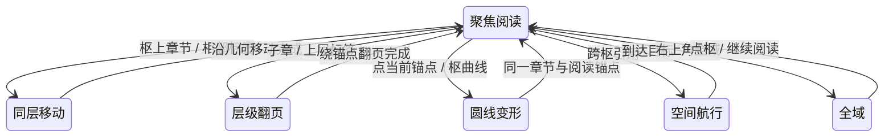

# 潮汐之间 · 空间读本 001

一座岛的三个视角：岸、塔、信。内容共 13 章，11 章叙事与 2 章搜索/设置，最深 3 层。正式首页使用原创作品；旧实现、框架与测试夹具可恢复。

## 枢承担交互

除右上角工具外，不设独立控制区。首页没有地点侧栏、底部导航、目录菜单、悬浮面板。全域直接点选枢，聚焦时点章节标签阅读，点当前锚点或枢的曲线改变形态。图标、章节标签与正文引用背景透明；键盘焦点以轮廓和环线表达。

颜色属于枢：岸青绿、塔暖赭、信靛蓝。章节继承所属枢，跨枢引用继承目标枢；背景透明不取消语义墨色。跨枢继续沿既有主题转场改变纸面，返回恢复原处主题。深色纸面使用对应浅色墨。

| 关系 | 作品中的例子 | 交互与动效 |
| --- | --- | --- |
| 同层 | 潮线 → 拾得物 → 回程 | 点枢上章节，或相邻标签；沿几何移动，键盘左右键仍可用 |
| 深入与上溯 | 潮线 ↔ 贝壳 | 圆内父子关系或曲线上的下层/上层标签；绕锚点翻页 |
| 圆与线 | 同一片岸 ↔ 一次往返 | 点当前枢/锚点触发 Möbius 变形，保持章节身份与可靠阅读锚点 |
| 跨枢 | 贝壳 → 信、蓝纸 → 塔 | 正文引用或全域枢曲线；空间航行 |
| 全域 | 看见岛上的三个视角与工具枢 | 右上角全域进入；直接点枢几何进入，键盘可聚焦曲线 |
| 返回 | 回到前一处阅读 | 右上角返回；由框架 history 决定，不与父章节混同 |

这是一张体验图，不另建状态机。导航、相机、历史、阅读位置与转场仍由 Reader/Field 所有。减弱动效沿用框架与系统偏好，声音和环境背景默认关闭，无新增自动存储。

## 形态的表现意义

圆态把关系并置，线态把一次经过展开；两种形态都能读正文，也都能导航。圆中空间充足时，一级子章沿分支布置，孙章节靠近所属父章并向外展开，连线表示父子关系；线中章节按作者安排编号，子章轻微缩进，并以锚点连到实际曲线上，不是另一块列表面板。

- 岸：“同一片岸”将潮线、拾得物、回程并置，贝壳从属于潮线；“一次往返”沿潮线、贝壳、拾得物、回程经过。
- 塔：“光的两面”并置守灯人的夜与窗外的海；“抵达以后”依次抵达、守候、回望。
- 信：“寄与未寄”并置来信和回音；“信的旅程”沿信封、来信、回音展开。

正文目前共用；差异来自关系构图与阅读路线，不强制“圆是目录、线是正文”。编号表达作者路线，不是已读进度，也不更改框架同级导航的定义。

## 手机、焦点与可达性

窄屏和可见空间不足时，不另开目录：只显示当前锚点及附近的上层、下层、前后章节标签。连线仍来自枢的实际材质点，必要时标签叶片避让屏幕边缘和正文，视觉位置与命中位置一起更新。当前形态控制与新增标签保持至少 44 像素的命中尺寸。全域只显示当前聚焦枢的名称；其他枢保留几何，曲线可点击、可键盘聚焦并带完整可访问名称。

正文滚动保留原机制；短屏中的后部引用需要滚动到相应段落。消失的章节控件若持有键盘焦点，等待翻页结束后交给可交互的当前锚点；期间若用户另选右上角工具，不夺回焦点。没有额外可见操作的隐藏键盘菜单；框架底栏在作品外壳内 display:none，不参与焦点顺序。

## 代码与所有权

- `src/examples/tide-atlas.ts`：作者内容，稳定 ID、层级、引用及枢 theme。
- `src/demos/tide-hub.ts`：纯目标帧投影，复用 LabelFrame、命中区域与语义键盘代理。所有章节叶片以目标章节 ID 标识，上下层/前后标签派发明确目标，避免同一槽位换含义后错用相对命令。
- `src/demos/tide-label-motion.ts`：唯一的作品标签表现缓存，以 entering / moving / leaving / settled 管理短暂姿态；没有章节、历史、相机或阅读位置的第二份所有权。圆线重排使用现有结构转场时钟，局部进退 240ms；关系线跟随实际绘制位置。退场标签不接收新点击，进入及主重排阶段暂停辅助命中；命中始终随实际绘制位置更新，稳定枢曲线与右上角仍可接收后续命令。减少动效时直接落到最终布局，销毁时清空。
- `src/demos/tide-edition.ts`：被动刊名与形态说明、引用颜色；无导航按钮，销毁时清理观察器和订阅。
- `src/demos/tide-edition.css`：作品排版、透明背景，以及只保留右上角独立工具的外壳规则。
- `Scene.setFrameProjection` 是内部作品接点，位于正文布局之后、命中与语义标签输出之前。公共 ReaderHandle 接口未扩展，也不向消费者暴露内部可变状态。
- `ReaderNavigation.overviewRegion` 在作品不显示底栏/地图面板时按实际可用区域取景；其他消费者保留标准导航。

同层移动同时保留逐渐退去和到来的普通锚点；层级翻页沿用框架 page pose，在两片页面侧立的交接瞬间交换内容；跨枢沿用阅读包络。不会在转场开始时删除整组标签，也不会因圆线中间曲线暂时超出屏幕而切换一次临时布局。

SVG/Pixi 接收同一份投影后的几何、标签墨色和命中区域。无旧预置签名的枢从 theme 推导墨色，旧签名保留。主曲线共鸣保留枢色，以线宽与透明度强调；图标不再画底板。

## 恢复与限制

旧首页在基线 `5fba31e05a57b47faef9e606c14235e4a20a5fd7`，开发入口 `/dev/legacy.html` 保留旧阅读、手册及 IX；原数据、夹具、公共工厂与用户工作区均未删除。前一版带侧栏/目录的完整补丁和离线文件保留在 evidence 中。

这仍是静态原创叙事，回信不收集输入。圆内关系图只用于小型内容；密集局部窗口另以 20 个长标题子章节、三层结构、两个枢验证，不宣称支持任意大图。手机呈现当前局部而非强塞完整圆内结构。手动缩放和返回遵循框架已有视野规则，源文本改变后的快照遵循既有锚点回退。独立消费者使用标准 Reader 外壳；本作品的枢内投影没有被提前抽成公共布局 API。

验证入口：npm run check、npm test、npm run test:reader，以及 tests/browser/tide-atlas.spec.ts、tests/browser/tide-meaning.spec.ts、tests/browser/tide-motion.spec.ts、tests/browser/tide-focus.spec.ts。生产、子路径和离线形式由 exports 浏览器测试覆盖。

## 聚焦标签与密集内容

“只显示聚焦的”在本作品解释为：标签所属枢必须是当前聚焦枢，而不是仅保留当前章节。当前枢内部的父子、同级关系仍可导航；其他枢的名称和悬挂引用标签不绘制。正文中的显式引用保留，右上角工具保留。焦点转移时清理旧枢表现缓存，避免两组标签混在一起。

标签目标布局与逐帧布局共用避让规则。正文是保留区域；标签保持字体大小，长标题在短标签中省略；手机局部导航使用所属同级序号区分长标题，完整名称留在可访问名称和提示中。多子章节或短横屏使用枢上的局部窗口，通过标签上的滚轮、拖动或上下箭头访问后续标签，窗口偏移由现有 Field.localScroll 所有。没有增加目录面板或第二份导航状态。

`tide-label-layout.ts` 负责边界、正文和标签之间的避让，移动时沿扩展矩形边缘寻找短路径，避免临时挪位造成跳帧；无法安全呈现的瞬间不提供遮挡正文的命中目标。`tide-local-window.ts` 只派生局部标签窗口。`installTideHubControls` 安装并清理作品投影、局部滚动范围和全域几何键盘代理，公共 ReaderHandle 不变。

翻页仍绕真实材质锚点进行。若叶片折向锚点时会穿过正文、屏幕边界或另一标签，则按实际变换后边界提前平滑收隐，进入安全区域再展开；不把折页改成瞬移，也不延迟章节身份提交。最小外边距与渐隐阈值一致，保证静止在屏幕边缘的箭头仍可操作。

## 连贯的层级翻页

层级变化使用同一材质锚点上的双叶交接：旧页从 0° 收至 90°，新页从 -90° 展至 0°；上溯反向；历史返回根据目标层级还原方向，先上溯再返回则重新向内展开。时长仍为 680ms，语义仍在 phase=0.5 原子提交；没有让正文绕不可见背面再转半圈。圆线 Möbius 变形、跨枢航行和同级沿几何移动保持各自语义。

翻页透明度只控制可见性，不再同时把正文推移和加重模糊。正文 transform-origin 指向当前标签的真实材质点，不使用正文外边缘作为第二个轴心，翻页期间透视视点也对齐同一锚点，避免屏幕中央视点让新页向标签侧偏出；几何正文已在屏幕坐标中排版，其数字帧 scale=1 与实际 DOM 相符。相机在一次层级翻页内保持不动；完成后仍允许既有可读区域取景。

新导航在隐藏交接时从页首开始；历史返回的已保存文本偏移、局部窗口偏移由同一次提交恢复，避免新页先展开在页首、再跳到旧位置。若屏宽或正文重新排版，进入页会在绘制前用最终正向几何校准语义锚点，再恢复翻页姿态；不等到动画完成才补跳。输入排队、异步内容准备和取消机制仍由 Field/ReadingSession 所有；减少动效直接完成，不引入第二个动画状态机。
